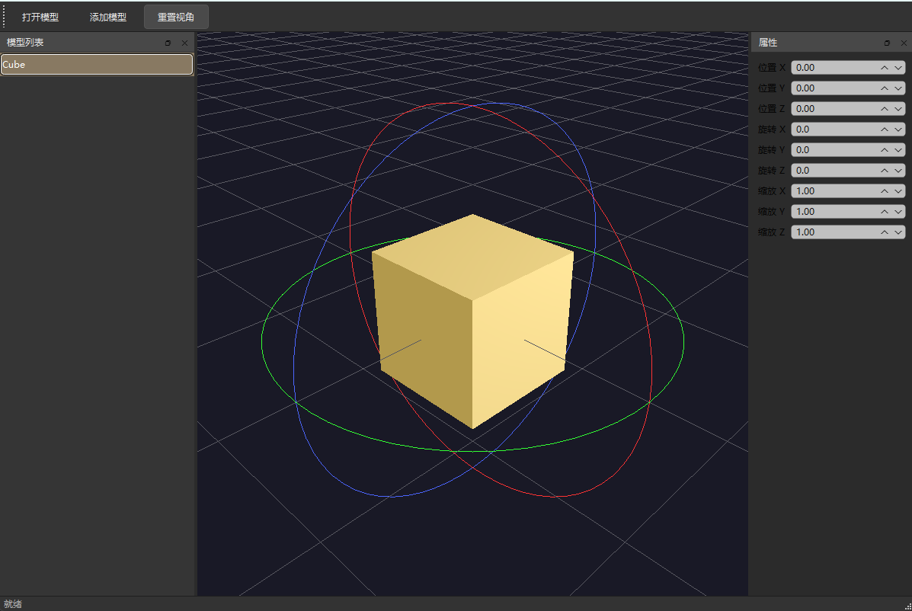

# ModelViewer

基于 Qt6 + OpenGL 3.3 Core Profile 的 3D 模型查看器。支持 OBJ/MTL 模型加载、多模型场景管理、射线拾取选中、拖拽移动与轨道相机。


## 功能特性

- **多模型场景**：同时加载多个 OBJ 模型，每个模型独立控制位置 / 旋转 / 缩放
- **模型列表（Outliner）**：左侧面板列出场景所有模型，与视口双向同步选中
- **射线拾取**：两级求交——AABB slab 粗筛 + Möller–Trumbore 三角面精测
- **选中高亮**：命中模型混入橙色高亮
- **拖拽移动**：选中后左键拖拽，沿相机朝向平面移动模型
- **轨道相机**：旋转 / 平移 / 缩放，支持按模型包围盒自动取景
- **光照**：世界空间 Blinn-Phong（环境光 + 漫反射 + 高光）
- **包围盒可视化**：显示模型 AABB（调试辅助）

## 技术栈

- C++17
- Qt6（Widgets / OpenGL / OpenGLWidgets）
- OpenGL 3.3 Core Profile
- CMake ≥ 3.16

## 构建

### 依赖

- Qt6（Widgets / OpenGL / OpenGLWidgets）
- OpenGL
- CMake ≥ 3.16、支持 C++17 的编译器

### 步骤

```bash
cmake -B build
cmake --build build
```

若 Qt6 不在默认搜索路径，需指定：

```bash
cmake -B build -DCMAKE_PREFIX_PATH=<Qt6 安装路径>
```

## 操作说明

| 操作 | 效果 |
|---|---|
| 左键点击 | 拾取选中模型 |
| 左键拖拽（选中后） | 移动该模型 |
| 右键拖拽 | 旋转相机（轨道） |
| 中键拖拽 | 平移相机 |
| 滚轮 | 缩放 |
| 左侧列表点击 | 选中对应模型（视口同步高亮） |

## 技术亮点

- **两级拾取**：屏幕像素 → NDC（y 翻转）→ 世界射线（`(projection · view).inverted()`）；对每个模型把射线逆变换到局部空间（点用 `map`、方向用 `mapVector`），先做 AABB slab 粗筛，再逐三角形 Möller–Trumbore 精测，取全局最近命中。
- **参数即状态**：模型矩阵 `M = T·R·S` 由 position/rotation/scale 每帧现算，避免累积漂移。
- **数据布局**：交错顶点布局，每顶点 8 个 float = 位置 xyz + 法线 xyz + UV xy。
- **资源管理**：`Mesh` 持有不可拷贝的 VAO/VBO，用 `std::unique_ptr` + `std::vector` 管理（QVector 隐式共享会触发写时复制导致编译错误）。
- **Outliner 同步**：列表行号 == 模型下标，不额外维护映射；用 `itemClicked` 而非 `currentRowChanged`，避免"未点击却选中模型"。

## 文件结构

| 文件 | 职责 |
|---|---|
| main.cpp / mainwindow.* | 主窗口与 UI（工具栏 + 左侧 Outliner 面板） |
| glwidget.* | QOpenGLWidget：渲染、轨道相机、光照、拾取、移动；发 modelsChanged/selectionChanged 信号供主窗口同步 |
| model.* | 场景模型：position/rotation/scale + 一组 Mesh + AABB + 三角面数据 |
| mesh.* | 单材质子网格：VAO/VBO/纹理 + draw |
| objloader.* | OBJ 解析（按 usemtl 分组为 SubMesh） |
| mtlloader.* | MTL 材质解析（Material：Kd、diffuseMap 等） |

## 许可

（待补充）
